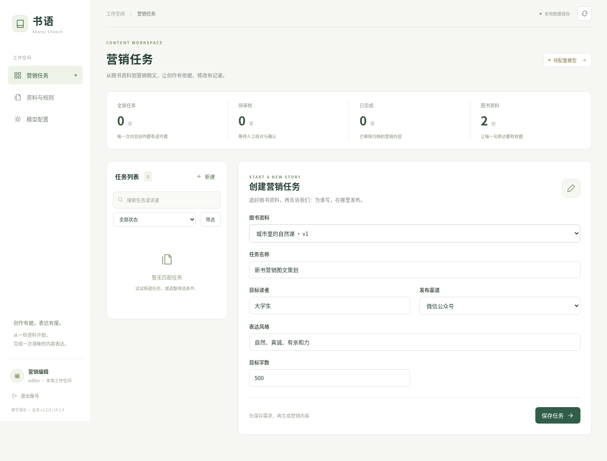
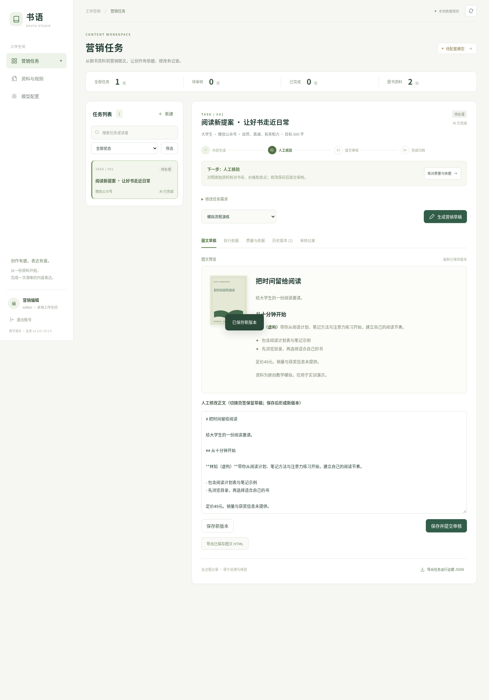

# UI 1.3 / 2026-11-18

本轮为视觉与交互引导更新，业务接口与数据库结构仍为v1.2.0。页面左下会同时显示业务版本与UI版本，便于与验收手册对应。

## 界面变化
- 白色导航侧栏、暖白背景、低饱和绿色重点色，统一线性SVG图标、间距、圆角和文字层级。
- 任务列表在左，创建与处理内容在右，不再把创建表单挤在任务列表下。
- 创建表单分组排版，主要操作清晰；任务选中后统计栏变紧凑，减少工作区占用。
- 新增“内容生成→人工核验→提交审核→完成归档”流程条，按实际状态显示下一步。
- 提交后明确提示使用reviewer审核，退回后提示按意见修改，完成后提示导出与查询。
- 图文预览更接近文稿阅读，编辑区与导出区分层；资料与配置页统一卡片和表单样式。
- 修复SVG封面缩小时的裁切；动作完成后恢复按钮图标。
- 顶部刷新按钮改为图标，保留title与aria-label“刷新状态”。

## 实际浏览器检查
在Linux Chromium headless中，使用临时数据库与真实Python后端，实际点击完成：
登录editor→创建任务→选择模拟模式生成→修改保存→质量检查→版本比较→连续两次导出→提交→reviewer退回→editor修改重提→reviewer通过→资料页→模型配置页。

1440、1366、1024、768、390像素宽度均未出现页面横向溢出；捕获的JavaScript pageerror为0。
本次生成明确使用simulation，不作为真实服务商调用证据；Windows和真实密钥仍需本人检查。

原37项后端/配置/业务测试和17项前端事件测试均继续通过。

## 可选复测
运行系统本身仍不需要第三方依赖。只有复测浏览器脚本时需要Python Playwright及其浏览器：
```
python -m pip install playwright
python -m playwright install chromium
python tests/browser_ui_smoke.py
```
脚本在临时目录启动独立后端（18770端口），不会修改本机data.db、密钥或任务；截图写入evidence/ui-smoke。请确保18770端口空闲。

## 更新
停止旧服务，git pull origin main，再py -3 app.py；浏览器Ctrl+F5。
现有验收Word中的角色、按钮业务含义和状态流程仍适用，创建表单现在位于任务工作区右侧。

## 界面截图

下图来自临时教学数据库的实际浏览器操作；正文为人工编辑的教学示例，生成环节为明确模拟模式。




